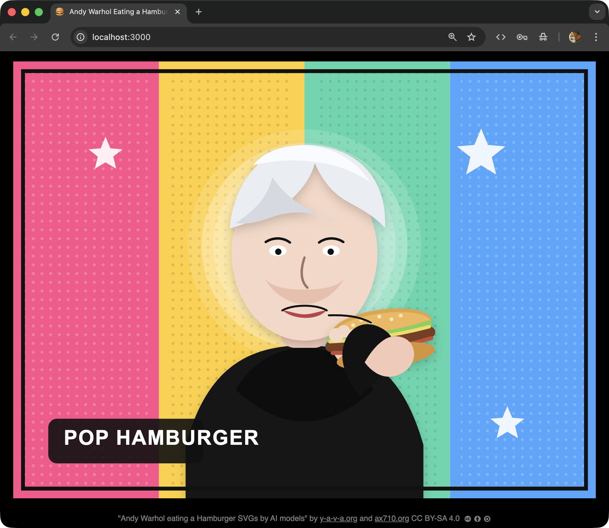

# Andy Warhol eating a Hamburger



**Prompt**

```
Can you write an svg file depicting Andy Warhol eating a hamburger?
```

A slideshow of SVGs generated by various AI models, each given the same prompt: draw Andy Warhol eating a hamburger.

Inspired by Simon Willison's [pelican on a bicycle](https://simonwillison.net/2024/Oct/25/pelicans-on-a-bicycle/) benchmark, which tests AI model SVG generation quality by asking each model to draw the same subject — a subject unlikely to exist verbatim in training data.

## Generating SVGs

`generate-svgs.js` sends the prompt to every text-to-text model on [OpenRouter](https://openrouter.ai) and saves the first `<svg>…</svg>` block from each response to `assets/<slug>.svg`. It skips a model if it already has an SVG in `assets/` or `rejected/`, is listed in `skip.json`, or has a `:batch` suffix. A model that returns a 400, 403, 404, 429 (rate limited) or a response without an `<svg>` is added to `skip.json`, so later runs skip it. Timeouts, 5xx errors, 401 and 402 are not, because they are usually temporary or caused by your own key or credit.

```sh
node generate-svgs.js [options]
```

### Options

| Option            | Description                                                                         |
| ----------------- | ----------------------------------------------------------------------------------- |
| `--add-skip <id>` | Add a model id to `skip.json` and exit. Can be repeated. `--add-skip=<id>` also works. |
| `-h`, `--help`    | Show help and exit.                                                                 |

### Environment variables

| Variable             | Default        | Description                                                                                  |
| -------------------- | -------------- | -------------------------------------------------------------------------------------------- |
| `OPENROUTER_API_KEY` | —              | Required, also for dry runs. Not needed for `--add-skip` or `--help`.                        |
| `LIMIT`              | `5`            | Maximum number of models to query in one run.                                                |
| `PROMPT`             | the prompt above | Replaces the base prompt.                                                                  |
| `FORCE`              | —              | Set to `1` to regenerate even when an SVG already exists.                                    |
| `ONLY`               | —              | Comma-separated substrings. Only models whose id contains at least one of them are queried.  |
| `SKIP`               | —              | Comma-separated model ids to skip for this run only.                                         |
| `AUTO_SKIP`          | —              | Set to `0` to stop adding models that return a 400, 403, 404, 429 or no `<svg>` to `skip.json`. |
| `DRY`                | —              | Set to `1` to list which models would be queried, without calling them.                      |
| `TIMEOUT`            | `180`          | Request timeout in seconds.                                                                  |
| `SLEEP`              | `2`            | Pause between requests in seconds.                                                           |

### Examples

```sh
LIMIT=10 node generate-svgs.js
ONLY=claude DRY=1 node generate-svgs.js
node generate-svgs.js --add-skip some-vendor/some-model
```

## Pipeline

Install the dev dependencies once with `npm install`, then run:

```sh
OPENROUTER_API_KEY=... npm run pipeline
```

This runs the following steps in order:

1. Checks that you are on `main` and that `assets/`, `index.html` and `skip.json` have no uncommitted changes, then fetches and fast-forwards `main` to `origin/main`. The pipeline stops if any check fails.
2. `generate-svgs.js` queries 10 models (override with `LIMIT`; the other environment variables above also apply).
3. `validate-svgs.js --fix --reject` checks each new SVG and tries these mechanical repairs on invalid ones: add a missing `xmlns` or `xmlns:xlink` declaration to the root `<svg>`, remove attributes without a value, keep only the last of duplicate attributes, escape a stray `&`, and replace common HTML entities such as `&nbsp;` with numeric ones. A file is only rewritten when the repaired version is valid. Otherwise the original is moved to `rejected/` (ignored by git) and its errors are added to `rejected/rejected.log`, so you can review it by hand. A rejected model is not added to `skip.json`, but it is not asked again while its SVG is in `rejected/`. Move a repaired file to `assets/`, or delete it to try that model again.
4. `update-svgs.sh` updates the SVG list in `index.html`.
5. The new SVGs, `index.html` and `skip.json` (when models were added to it) are committed as "adds new svgs", or "updates skip list" when there are no new SVGs. Anything else you had changed or staged is left out of the commit.
6. The commit is pushed to `origin/main`. If the push fails, the commit stays local and you can push it yourself.

An SVG is valid when it is well-formed XML, every namespace prefix (such as `xlink:`) is declared, and the root is `<svg>` in the `http://www.w3.org/2000/svg` namespace. These are the requirements for `index.html` to render it through `<object type="image/svg+xml">`.

### Scripts

| Script                 | Description                                         |
| ---------------------- | --------------------------------------------------- |
| `npm run pipeline`     | Generate, validate, update `index.html`, commit and push. |
| `npm run generate`     | Run `generate-svgs.js` only.                        |
| `npm run validate`     | Validate every SVG in `assets/`.                    |
| `npm run validate:new` | Validate only untracked SVGs in `assets/`.          |
| `npm run fix`          | Apply the safe fixes to every SVG, then validate.   |
| `npm run update`       | Run `update-svgs.sh` only.                          |

"Andy Warhol eating a Hamburger SVGs by AI models" by [y-a-v-a.org](https://y-a-v-a.org) and [ax710.org](https://ax710.org), 2026, is licensed under [CC BY-SA 4.0](https://creativecommons.org/licenses/by-sa/4.0/).